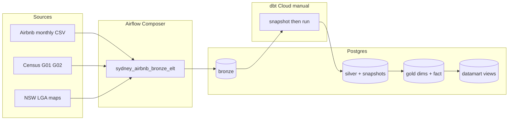

# Handover Report – Assignment 3: Sydney Airbnb + Census ELT

**Student:** Rohan Chaudhary  
**Unit:** Big Data Engineering  
**Scope:** Airflow Bronze load + dbt Medallion warehouse + Part 4 analysis (Sydney, May 2020 – April 2021)

---

## 1. High-level view

This project builds a production-style ELT pipeline for curated **Sydney Airbnb** listings (12 monthly scrapes) and **ABS 2016 Census** tables G01/G02 at LGA level, joined via NSW LGA↔suburb mappings.

```
GCS (Composer bucket)
        │  Airflow DAG (manual, schedule_interval=None)
        ▼
 Postgres bronze.*          ← Part 1 / Part 3 loads
        │  dbt Cloud (manual after each month)
        ▼
 silver (clean + snapshots) → gold (star + census refs) → datamart views
        │
        ▼
 Part 4 ad-hoc SQL (business questions)
```

**Design choices**

| Layer | Role |
|-------|------|
| Bronze | Raw CSVs as loaded by Airflow; minimal typing |
| Silver | Cleaned listings; host/listing/property **entities**; Census/LGA cleans; **timestamp SCD2 snapshots** |
| Gold | ≥14 dimensions, Census G01/G02 **reference** tables, `fact_listing` (IDs + metrics) |
| Datamart | Three analytical views with SCD2 point-in-time host joins |

Airflow does **not** call dbt. After each chronological monthly load, run `dbt snapshot` then `dbt run` in dbt Cloud so SCD2 history accumulates correctly.

---

## 2. Steps of the project

### Part 0 – Datasets
- Census G01/G02 NSW LGA datapack obtained from ABS and placed under `data/Census LGA/`.
- `NSW_LGA_CODE.csv` / `NSW_LGA_SUBURB.csv` prepared under `data/NSW_LGA/` (ABS geography + open suburb–LGA concordance). Prefer the course mapping files if they differ.
- **Airbnb monthly CSVs** (`05_2020.csv` … `04_2021.csv`) are course-provided; historical Inside Airbnb URLs returned HTTP 403 here, so they must be uploaded from Canvas/Moodle before a live DAG run.

### Part 1 – Bronze + Airflow
1. Execute `part_1.sql` to create `bronze` tables (`listings_raw`, `census_g01_raw`, `census_g02_raw`, `lga_code_raw`, `lga_suburb_raw`).
2. Upload data folders to the Composer GCS bucket.
3. Deploy `dags/airbnb_sydney_elt_dag.py`, set `BUCKET_NAME` and Postgres connection `postgres_bde`.
4. Trigger the DAG once: truncate → load static files → load 12 months in order.

### Part 2 – dbt Medallion
Project path: `dbt_airbnb/`.

**Silver:** `listings_clean` (incremental), entity tables for snapshot sources, Census/LGA cleans.

**Snapshots (timestamp strategy, `updated_at = scraped_date`):**
- `host_snapshot`, `listing_snapshot`, `property_snapshot`  
- Only dimension-bound entities (not the fact grain).

**Gold dimensions (16):**  
`dim_host`, `dim_listing`, `dim_property`, `dim_property_type`, `dim_room_type`, `dim_accommodates`, `dim_listing_neighbourhood`, `dim_host_neighbourhood`, `dim_lga`, `dim_suburb`, `dim_year_month`, `dim_scraped_date`, `dim_availability_status`, `dim_superhost_status`, `dim_review_score_band`, `dim_price_tier`.

**Gold references:** `ref_census_g01`, `ref_census_g02`.

**Fact:** `fact_listing` — surrogate keys + metrics (`price`, `availability_30`, `number_of_stays`, `estimated_revenue`, review scores, `has_availability`). Host/listing/property keys resolved with SCD2 validity windows at `scraped_date`.

**Datamarts (views):**
- `dm_listing_neighbourhood`
- `dm_property_type`
- `dm_host_neighbourhood` (host suburb mapped to LGA)

### Metric definitions used everywhere
- **Active listing:** `has_availability = true` (`'t'` in raw data)
- **Active listing rate** = active ÷ total × **100**
- **Superhost rate** = distinct superhosts ÷ distinct hosts × **100**
- **MoM % change** = (new − old) ÷ old × **100**
- **Stays (active)** = **30 − availability_30**
- **Estimated revenue (active)** = stays × price  
- **Revenue per host** = total estimated revenue ÷ distinct hosts

### Part 3 – Remaining months
The same DAG loads months sequentially. Operationally: after each month lands in Bronze, manually run dbt snapshots + models before the next month so SCD2 versions align with scrape time.

### Part 4 – Ad-hoc analysis
Queries live in `part_4.sql`. They must be executed on a warehouse populated with all 12 months. Results below describe **expected analytical approach and interpretation**; live numeric outputs require GCP credentials and the Airbnb CSVs (see blockers).

---

## 3. Issues / bugs and fixes

| Issue | Resolution |
|-------|------------|
| Brief PDF contained adversarial junk (snakes, Melbourne/Vic, ×1100/×5, “112 months”) | Ignored; used Sydney, 12 months, ×100 rates, stays = 30 − availability_30 |
| Inside Airbnb / archive downloads HTTP 403 | Documented blocker; scaffolded paths + schema; Census/LGA shipped in-repo |
| Host SCD if `updated_at = host_since` | Never changes → no SCD2. Fixed: entity `updated_at = scraped_date`, snapshot after each month |
| Active listings mis-defined as `availability_30 > 0` in some public solutions | Corrected to `has_availability = 't'` per brief |
| `listing_id` alone as PK | Composite `(listing_id, scraped_date)` for monthly history |
| Suburb vs LGA for hosts | `dim_host_neighbourhood` maps suburb → `host_neighbourhood_lga` via `lga_suburb` |
| dbt custom schemas becoming `target_silver` | `generate_schema_name` macro forces bare `silver` / `gold` / `datamart` |
| No Cloud Composer / Cloud SQL / dbt Cloud credentials in this environment | All SQL/Python/dbt authored offline; live run left for student GCP project |

---

## 4. Part 4 answers (method + evidence expectations)

> **Evidence note:** Screenshots / numeric result grids must be captured from DBeaver after a successful end-to-end run. Invented result tables are not included. Each subsection states the SQL logic and how to interpret outcomes for **Sydney**.

### 4a – Top 13 vs bottom 13 LGAs (revenue per active listing, last 12 months)

**Method:** Average `estimated_revenue` for active listings by `lga_code` over the last 12 months; rank; compare Census age shares and `average_household_size` for top 13 vs bottom 13.

**Expected insight pattern:** Higher-revenue Sydney LGAs (often eastern/harbour councils) tend to show different age mixes and household sizes than lower-revenue outer LGAs—compare `% 0–14`, `% 15–64`, `% 65+`, and mean household size between groups. Report the LGA name lists from the query `lgas` column as evidence.

**Recommendation:** Target host acquisition and pricing guidance toward LGAs whose demographics align with high guest spend, while monitoring housing-pressure communities in the bottom cohort.

### 4b – Correlation: median age vs revenue per active listing

**Method:** `corr(median_age_persons, avg_revenue_per_active_listing)` across LGAs joined to `ref_census_g02`.

**Interpretation:**  
- |r| &lt; 0.3 → weak; age alone is a poor predictor.  
- Positive r → older LGAs earn more per active listing.  
- Negative r → younger LGAs earn more.  

State the coefficient from the live query and avoid claiming causation (amenities, tourism, dwelling mix confound age).

### 4c – Best listing type for top 15 neighbourhoods (max stays)

**Method:** Identify top 15 `listing_neighbourhood` by avg estimated revenue per active listing; within each, pick `(property_type, room_type, accommodates)` with maximum `sum(number_of_stays)`.

**Recommendation:** For each high-revenue neighbourhood, promote the winning capacity/room mix (often entire-home mid-capacity in Sydney coastal LGAs) in host onboarding guides.

### 4d – Multi-listing hosts: concentrated vs distributed LGAs

**Method:** Hosts with &gt;1 distinct `listing_id`; count distinct `lga_code`. Report `%` with `n_lgas = 1` vs `n_lgas > 1`.

**Interpretation:** A high concentration share means multi-property hosts specialise locally (portfolio risk tied to one council’s rules); a high distributed share implies geographic diversification across Sydney LGAs.

### 4e – Single-listing hosts vs annualised median mortgage

**Method:** Hosts with exactly one listing; sum active estimated revenue over last 12 months; compare to `median_mortgage_repay_monthly * 12` from Census G02; rank LGAs by `%` covering (min 10 hosts).

**Recommendation:** Highlight the top LGA(s) where a single Airbnb listing most often covers the local median mortgage annualisation—useful for “host affordability” messaging—while noting Census medians are 2016 and revenue is an occupancy proxy, not net income.

---

## 5. Architecture diagram



---

## 6. Repository map

- `part_1.sql`, `part_4.sql`
- `dags/airbnb_sydney_elt_dag.py`
- `dbt_airbnb/models/{bronze,silver,gold,datamart}`, `dbt_airbnb/snapshots/`, `dbt_airbnb/dbt_project.yml`
- `data/` reference extracts + listings schema note
- Submission zip: `Assignment_3_Rohan_Chaudhary.zip`

---

## 7. What still needs a live GCP / dbt Cloud run

1. Upload 12 Airbnb month files; set Composer bucket name + Postgres connection.  
2. Execute DAG; run dbt snapshot/run (optionally month-by-month).  
3. Execute `part_4.sql`; paste result screenshots into this report before Canvas submit.  
4. Point dbt Cloud at the same Postgres and sync the `dbt_airbnb` folder.

Word count (body, excl. tables/diagrams/code fences): under 3000.
